# HelpDesk — Support Ticket Management Platform

> A full-stack support-ticket application taken through a complete DevOps lifecycle:
> **Git → tests → Docker → GitHub Actions CI/CD → Trivy security scan → GHCR → Terraform (AWS VPC + EKS) → Kubernetes + Helm → Prometheus + Grafana.**

**Repository:** <https://github.com/parthtaneja0001/helpdesk-devops-capstone>

## Table of contents

1. [What the application does](#1-what-the-application-does)
2. [Demo video](#2-demo-video)
3. [Architecture](#3-architecture)
4. [Tech stack](#4-tech-stack)
5. [Repository layout](#5-repository-layout)
6. [Module 1 — Application (frontend, backend, database)](#6-module-1--application-frontend-backend-database)
7. [Module 2 — Testing](#7-module-2--testing)
8. [Module 3 — Git and GitHub](#8-module-3--git-and-github)
9. [Module 4 — Docker and Docker Compose](#9-module-4--docker-and-docker-compose)
10. [Module 5 — CI/CD with GitHub Actions](#10-module-5--cicd-with-github-actions)
11. [Module 6 — DevSecOps with Trivy](#11-module-6--devsecops-with-trivy)
12. [Module 7 — Terraform on AWS](#12-module-7--terraform-on-aws)
13. [Module 8 — Kubernetes and Helm](#13-module-8--kubernetes-and-helm)
14. [Module 9 — Observability](#14-module-9--observability)
15. [Module 10 — Live demo flow](#15-module-10--live-demo-flow)
16. [Cleanup and cost control](#16-cleanup-and-cost-control)
17. [Troubleshooting notes](#17-troubleshooting-notes)

---

## 1. What the application does

HelpDesk is a support-ticket tracker for a support team. Staff can:

- log customer issues as **tickets** (title, description, requester, assignee),
- set a **priority** (`low`, `medium`, `high`, `urgent`),
- move tickets through a **status** workflow: `open → in_progress → resolved → closed`,
- filter tickets by status, and
- see **live KPI cards** (total, open, in progress, resolved, urgent-and-active tickets).

## 2. Demo video

A recorded walkthrough of the full flow: **commit a change → pipeline runs (tests, build, Trivy, push) → new SHA-tagged image in GHCR → `helm upgrade` on EKS → updated app in the browser.**

[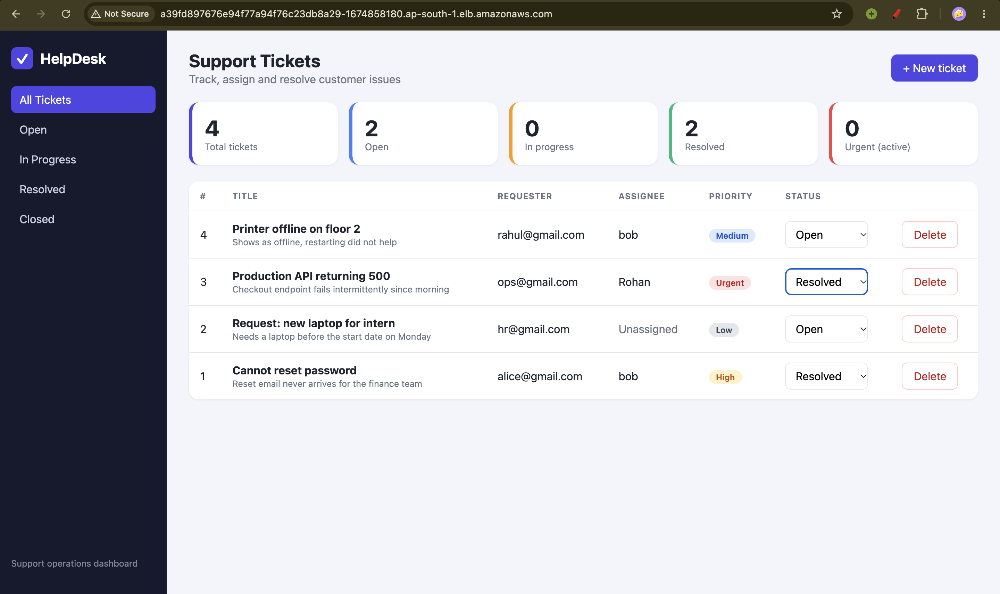](https://drive.google.com/file/d/1akWYIZ53DCBeI_8r9EHGJC3Ik-XkhUro/view?usp=sharing)

▶ **[Watch the demo video](https://drive.google.com/file/d/1akWYIZ53DCBeI_8r9EHGJC3Ik-XkhUro/view?usp=sharing)**

## 3. Architecture

```
Developer
   │  git push
   ▼
GitHub ──► GitHub Actions
             ├─ pytest                       (fails the build on any test failure)
             ├─ frontend build (Vite)
             ├─ Docker build  (backend + frontend)
             ├─ Trivy scan    (fails on HIGH / CRITICAL)
             └─ push to GHCR  (tag = commit SHA)
                                   │
 Terraform ──► AWS VPC + EKS ──► Helm ──► Kubernetes (namespace: helpdesk)
                                            ├─ frontend  (React + Nginx, 2 replicas)
                                            ├─ backend   (FastAPI, 2 replicas, HPA 2–4)
                                            ├─ postgres  (StatefulSet + EBS volume)
                                            └─ ingress   (/ → frontend, /api → backend)
                                                  │
                                 Prometheus (ServiceMonitor) ──► Grafana
```

## 4. Tech stack

| Layer | Technology |
|-------|-----------|
| Frontend | React 18 + Vite, responsive CSS, served by unprivileged Nginx |
| Backend | FastAPI, SQLAlchemy 2, Alembic, `prometheus-fastapi-instrumentator` |
| Database | PostgreSQL 16 |
| Tests | pytest + FastAPI TestClient on in-memory SQLite |
| Containers | Docker, Docker Compose |
| CI/CD | GitHub Actions, GitHub Container Registry (GHCR) |
| Security | Trivy image scanning |
| Infrastructure as Code | Terraform (VPC + EKS, community modules) |
| Orchestration | Kubernetes (EKS 1.31), Helm, ingress-nginx, HPA |
| Observability | kube-prometheus-stack (Prometheus + Grafana), ServiceMonitor |

## 5. Repository layout

```
backend/              FastAPI app (app/), Alembic migrations (alembic/), tests (tests/), Dockerfile
frontend/             React app (src/), Nginx config template, multi-stage Dockerfile
docker-compose.yml    Full local stack: postgres + backend + frontend
.github/workflows/    ci.yml — test, build, scan, push (and optional Helm deploy)
terraform/            AWS VPC + EKS
k8s/                  namespace.yaml, storageclass-gp3.yaml
helm/helpdesk/        Helm chart (Chart.yaml, values.yaml, values-dev.yaml, templates/)
monitoring/           Prometheus/Grafana Helm values + Grafana dashboard ConfigMap
scripts/              load-test.sh traffic generator
docs/screenshots/     Evidence screenshots shown in this README
```

---

## 6. Module 1 — Application (frontend, backend, database)

### REST API

| Method | Path | Purpose |
|--------|------|---------|
| `GET` | `/api/tickets?status=&priority=` | List and filter tickets |
| `GET` | `/api/tickets/{id}` | Get one ticket |
| `POST` | `/api/tickets` | Create a ticket |
| `PUT` | `/api/tickets/{id}` | Update a ticket (partial update) |
| `DELETE` | `/api/tickets/{id}` | Delete a ticket |
| `GET` | `/api/tickets/stats` | Counts for the dashboard KPI cards |
| `GET` | `/health` | Liveness probe |
| `GET` | `/ready` | Readiness probe (checks the database) |
| `GET` | `/metrics` | Prometheus metrics |

### Database and migrations

The `tickets` table is created by an Alembic migration (`backend/alembic/versions/0001_create_tickets_table.py`) that the backend container
applies on start (`alembic upgrade head`) before launching Uvicorn.

### Frontend dashboard

A dark sidebar with status filters, KPI cards, a ticket table with priority badges and an inline status dropdown, a create-ticket modal, and a responsive layout with loading and error states.

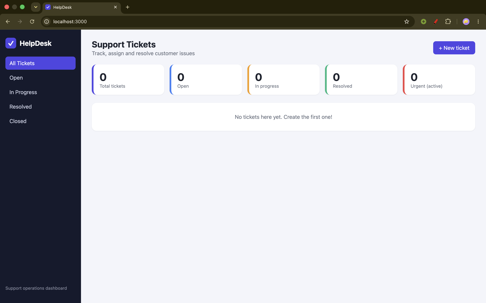

### Interactive API documentation (Swagger)

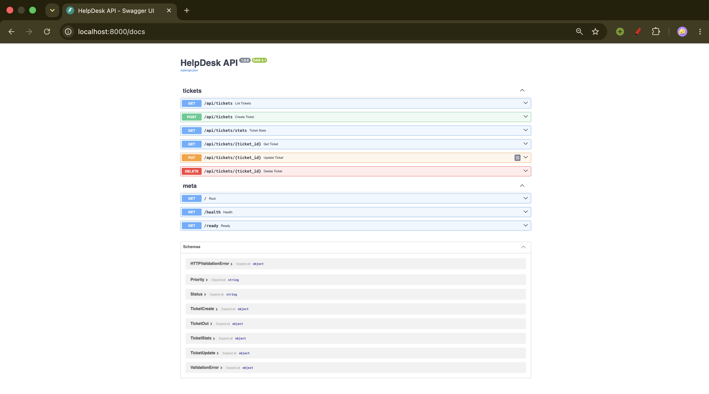

## 7. Module 2 — Testing

11 pytest tests cover health, readiness, metrics and full ticket CRUD, including validation errors, 404s, filtering and the stats endpoint.
`backend/tests/conftest.py` overrides the database dependency with an **in-memory SQLite** database, so tests never touch the real PostgreSQL. `backend/pytest.ini` configures the test path.

```bash
cd backend
python3.12 -m venv .venv && source .venv/bin/activate
pip install -r requirements.txt
pytest -v
```

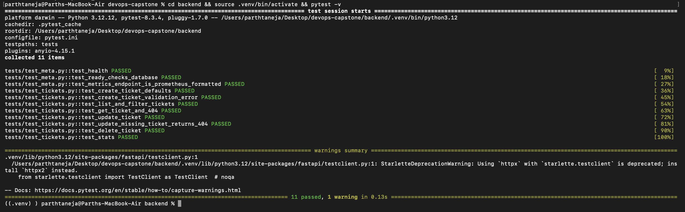

## 8. Module 3 — Git and GitHub

- Public repository, `main` branch, conventional commit messages (`feat:`, `fix:`, `ci:`, `docs:`, `build:`, `test:`).
- `.gitignore` excludes `.env`, `__pycache__`, `node_modules`, `.venv`, Terraform state and `*.tfvars`.
- No credentials are committed.

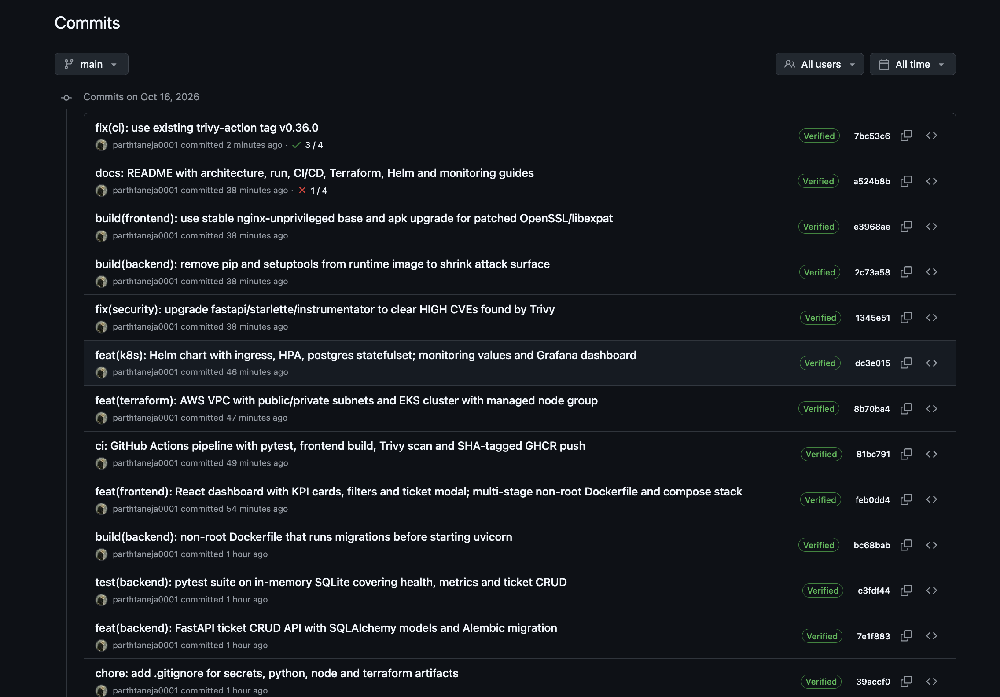

## 9. Module 4 — Docker and Docker Compose

**Backend image** (`backend/Dockerfile`): `python:3.12-slim`, dependencies installed, pip/setuptools removed afterwards, runs as non-root **uid 10001**, applies migrations then starts Uvicorn.

**Frontend image** (`frontend/Dockerfile`): **multi-stage** — `node:22-alpine` builds the Vite app, then `nginx-unprivileged` serves the static files as non-root **uid 101**. Nginx proxies `/api/` to the backend using the `BACKEND_URL` environment variable.

Run the whole stack with one command:

```bash
docker compose up --build
```

- App: <http://localhost:3000>
- API docs: <http://localhost:8000/docs>
- Metrics: <http://localhost:8000/metrics>

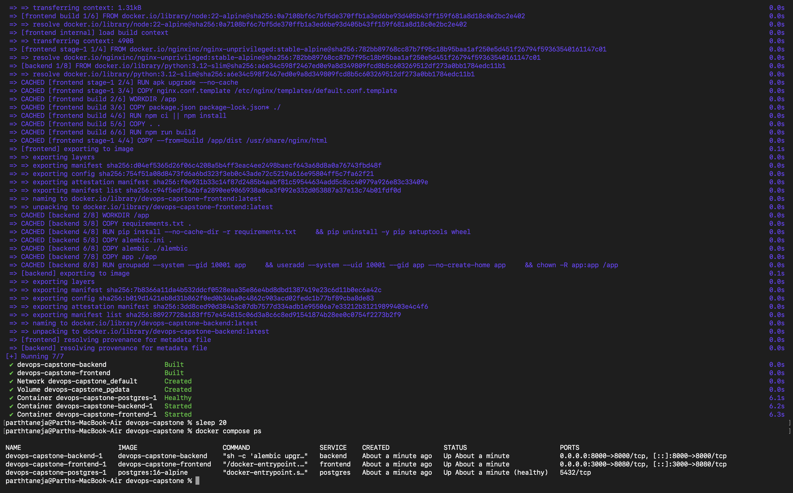

## 10. Module 5 — CI/CD with GitHub Actions

Workflow: [`.github/workflows/ci.yml`](.github/workflows/ci.yml), triggered on every push to `main`.

| Job | What it does |
|-----|--------------|
| **test** | Installs dependencies, runs `pytest` (build fails on any failure), then builds the React frontend |
| **build-scan-push** (matrix: backend, frontend) | Builds the image → **Trivy scan** → pushes to GHCR tagged with the **commit SHA** (never `latest`) |
| **deploy** (optional) | `helm upgrade --install`, enabled with the repo variable `DEPLOY_ENABLED=true` and a `KUBECONFIG_B64` secret |

Images are scanned **before** they are pushed, so a vulnerable image never reaches the registry.

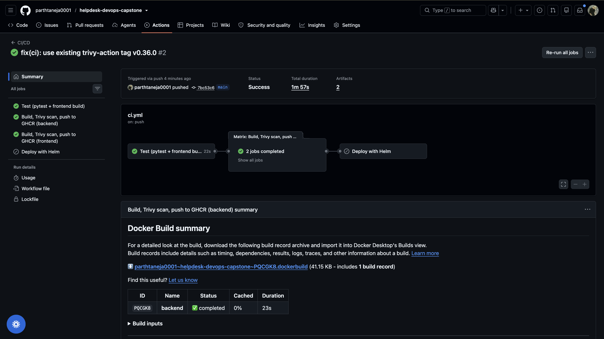

### Images in GitHub Container Registry

Both images are published as `ghcr.io/parthtaneja0001/helpdesk-devops-capstone-{backend,frontend}:<git-sha>`.

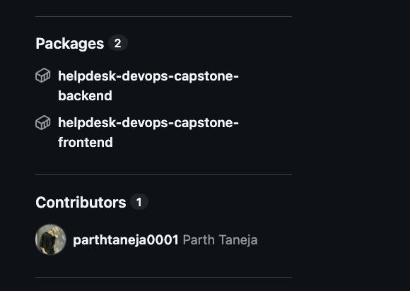

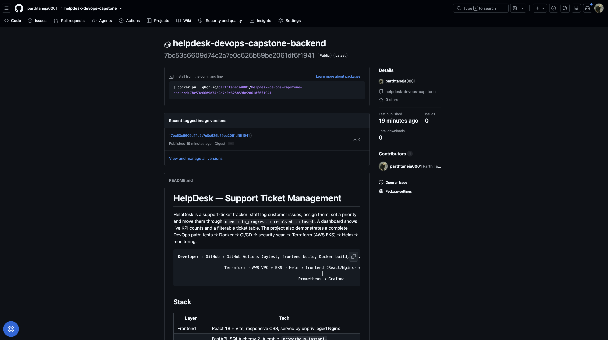

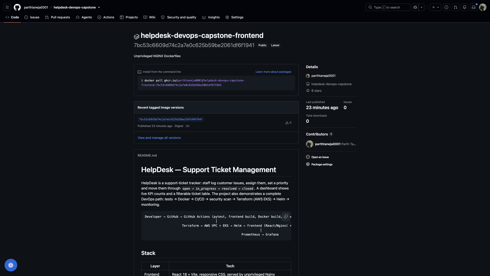

## 11. Module 6 — DevSecOps with Trivy

Trivy runs in the pipeline on **both** images with `severity: HIGH,CRITICAL`, `ignore-unfixed: true` and `exit-code: 1`, so any fixable HIGH or CRITICAL vulnerability fails the build.

**What was scanned and what it means:** Trivy scans each built image's OS packages (Debian for the backend, Alpine for the frontend) and its Python packages against known-CVE databases.
The first local scan found HIGH vulnerabilities — for example **CVE-2026-48818 in Starlette** (SSRF via UNC paths in `StaticFiles`) and several OpenSSL/libexpat issues in the old Alpine base.
They were fixed by upgrading FastAPI/Starlette, switching to the current `nginx-unprivileged` base with `apk upgrade`, and removing pip/setuptools from the runtime image.
Both images now scan clean (0 HIGH/CRITICAL), and the pipeline keeps enforcing that.

### Backend image scan

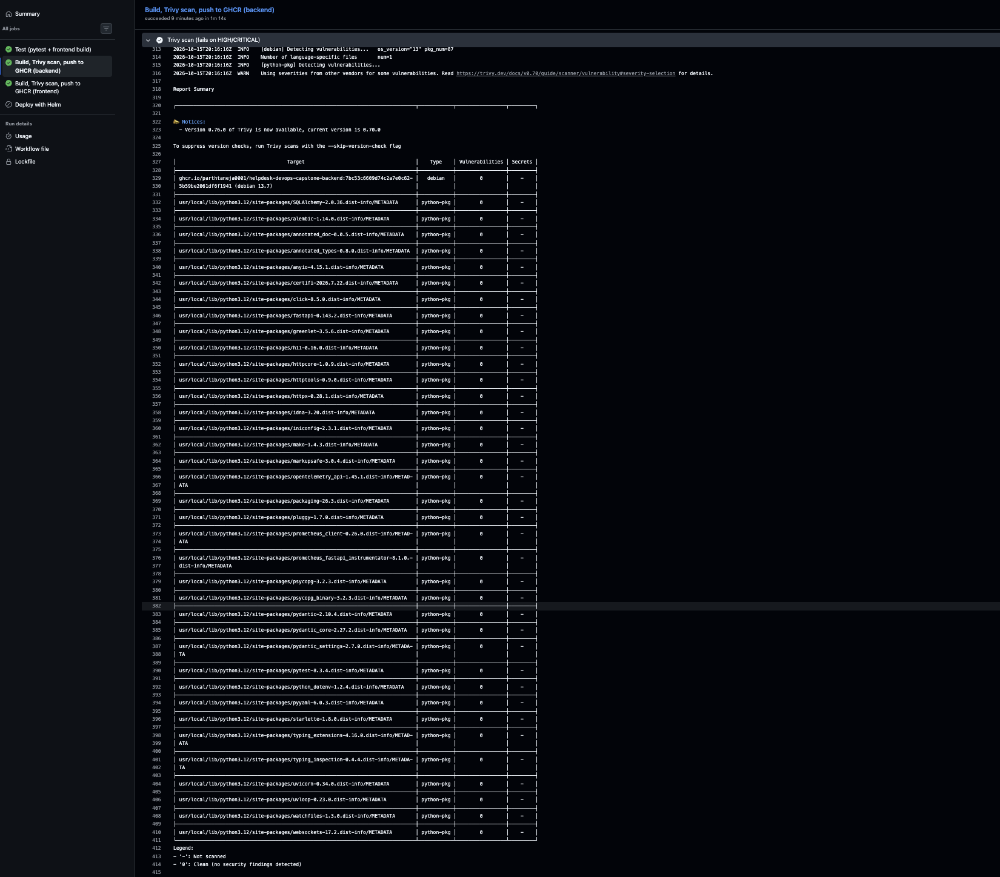

### Frontend image scan

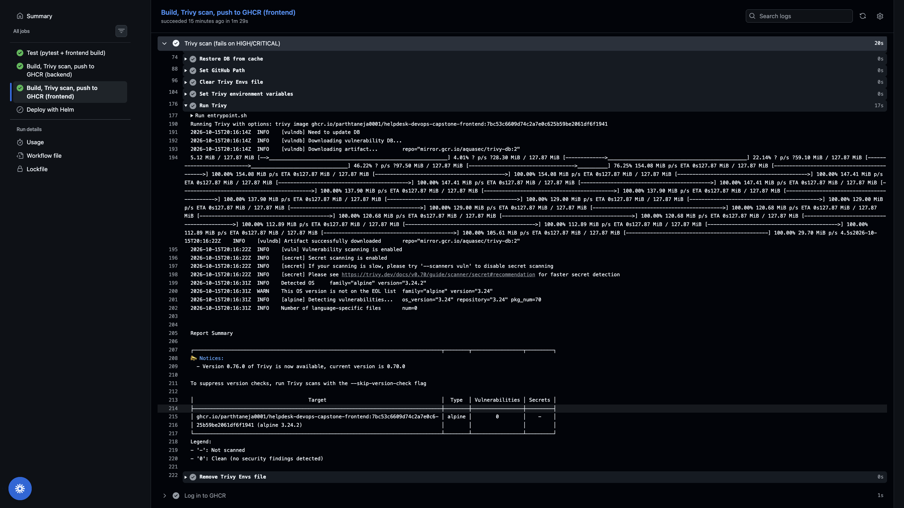

## 12. Module 7 — Terraform on AWS

The `terraform/` directory provisions, in `ap-south-1` (Mumbai):

- a **VPC** (`10.0.0.0/16`) with **2 public** and **2 private** subnets across two availability zones, an internet gateway and a NAT gateway,
- an **EKS cluster** (Kubernetes 1.31) with a **managed node group** (2 × `m7i-flex.large`),
- core add-ons (CoreDNS, kube-proxy, VPC CNI) and the **EBS CSI driver** with an IRSA role for persistent volumes.

```bash
cd terraform
cp terraform.tfvars.example terraform.tfvars   # no credentials here — use `aws configure`
terraform init
terraform plan
terraform apply
$(terraform output -raw configure_kubectl)
```

> **Free-tier AWS accounts** only allow certain instance types. `t3.medium` is rejected, so this project sets `node_instance_types = ["m7i-flex.large"]` in `terraform.tfvars`.

### `terraform init`

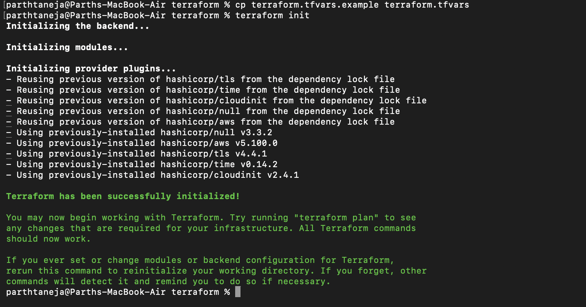

### `terraform plan` (61 resources to add)

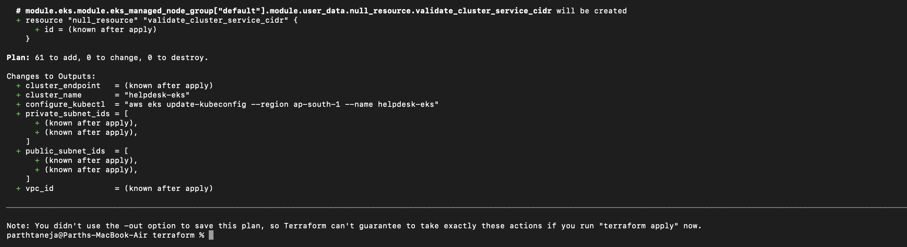

### `terraform apply`

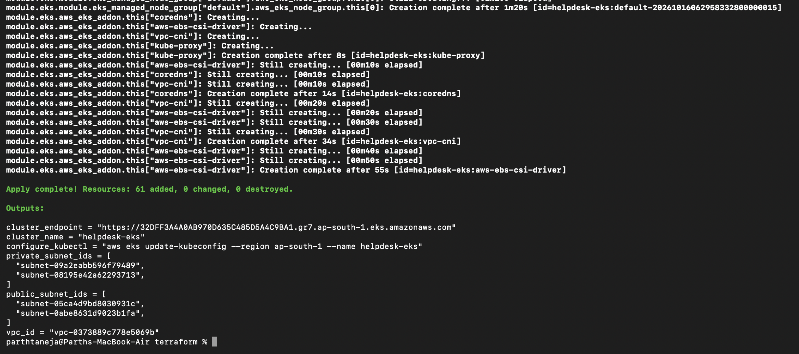

### VPC in the AWS Console (ap-south-1)

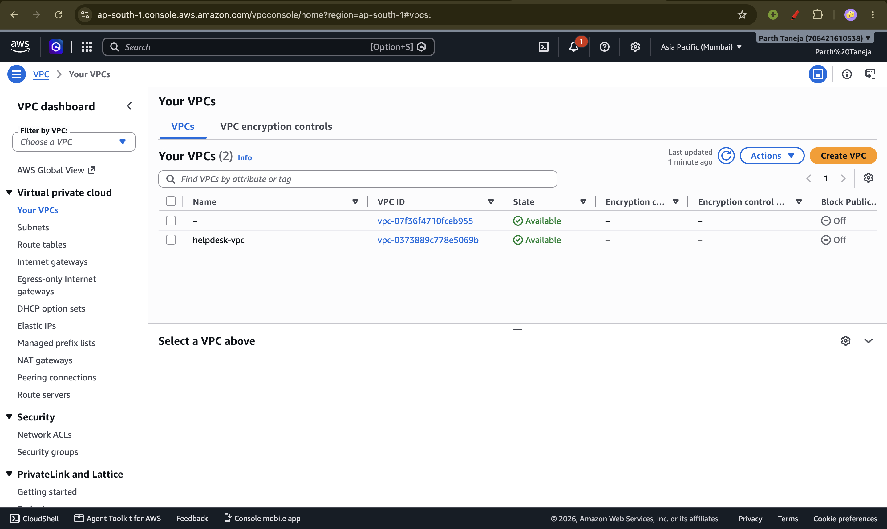

### Public and private subnets

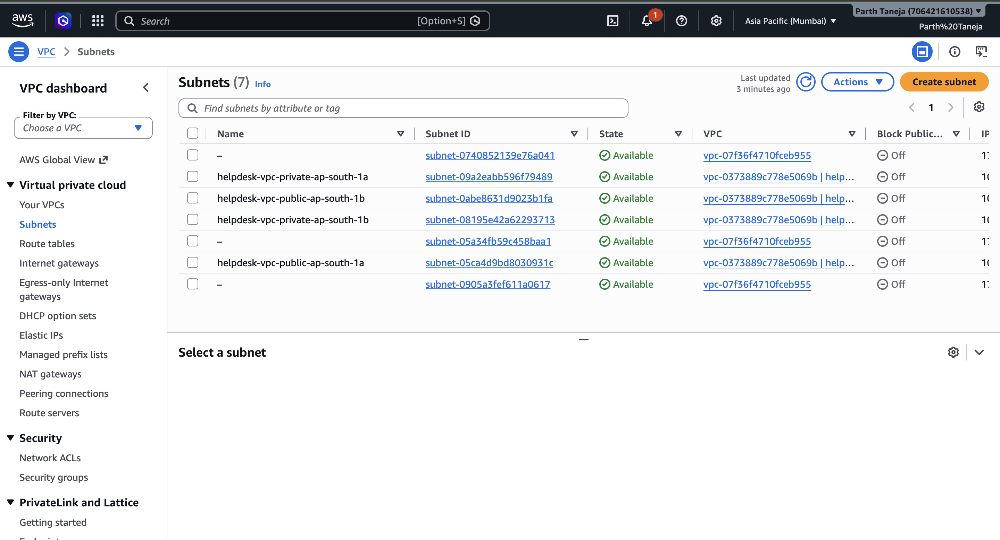

### EKS cluster (Active, Kubernetes 1.31)

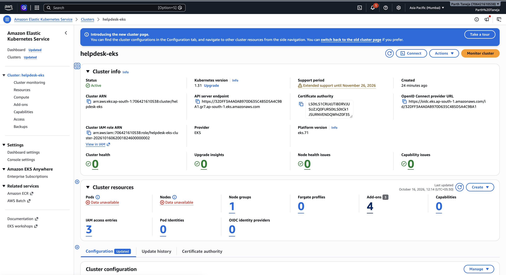

### Worker nodes (`kubectl get nodes`)

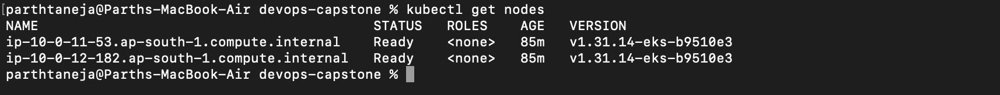

### `terraform destroy`

All resources were destroyed after the evaluation to avoid AWS charges.

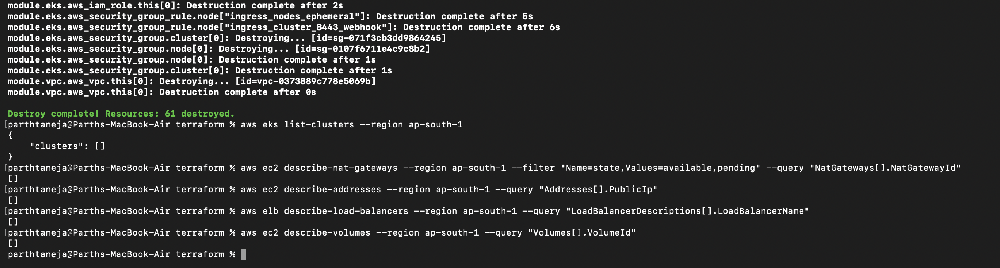

## 13. Module 8 — Kubernetes and Helm

The Helm chart in [`helm/helpdesk`](helm/helpdesk) deploys everything into the `helpdesk` namespace:

| Resource | Details |
|----------|---------|
| Namespace | `k8s/namespace.yaml` |
| Backend Deployment | 2 replicas, liveness `/health`, readiness `/ready`, non-root, resource requests/limits |
| Frontend Deployment | 2 replicas, Nginx health probes, non-root |
| PostgreSQL | StatefulSet with a 2 GiB EBS volume, credentials in a Secret |
| Services | ClusterIP services for backend and frontend (headless for Postgres) |
| Ingress | `/` → frontend, `/api` → backend (ingress-nginx) |
| HPA | Backend scales 2–4 pods at 70 % CPU |
| ServiceMonitor | Lets Prometheus scrape the backend `/metrics` |

### Deploy steps

```bash
# 1. Cluster add-ons
kubectl apply -f k8s/storageclass-gp3.yaml          # default storage class for the Postgres PVC
helm repo add prometheus-community https://prometheus-community.github.io/helm-charts
helm repo update
helm install kube-prometheus-stack prometheus-community/kube-prometheus-stack \
  -n monitoring --create-namespace -f monitoring/prometheus-values.yaml
kubectl apply -f monitoring/dashboard-configmap.yaml
helm upgrade --install ingress-nginx ingress-nginx --repo https://kubernetes.github.io/ingress-nginx \
  -n ingress-nginx --create-namespace

# 2. Load-balancer address
export ELB=$(kubectl get svc -n ingress-nginx ingress-nginx-controller \
  -o jsonpath='{.status.loadBalancer.ingress[0].hostname}')

# 3. The application (images are tagged with the Git commit SHA)
kubectl apply -f k8s/namespace.yaml
helm upgrade --install helpdesk ./helm/helpdesk -n helpdesk \
  -f helm/helpdesk/values-dev.yaml \
  --set ingress.host=$ELB \
  --set backend.image.repository=ghcr.io/<owner>/<repo>-backend \
  --set frontend.image.repository=ghcr.io/<owner>/<repo>-frontend \
  --set backend.image.tag=<git-sha> --set frontend.image.tag=<git-sha> \
  --set postgres.password='<strong-password>'
```

### Pods (all Running)

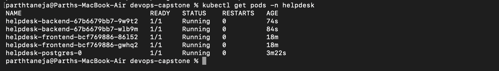

### Services (ClusterIP)

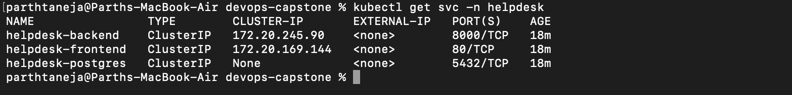

### Helm release

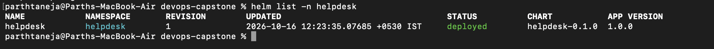

### Ingress

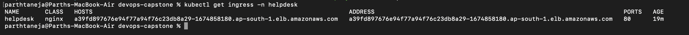

### Application served through the Ingress load balancer


## 14. Module 9 — Observability

The backend exposes Prometheus metrics at `/metrics` (request count, latency histogram, in-flight requests).
A `ServiceMonitor` tells the Prometheus Operator to scrape it, and a provisioned Grafana dashboard (**HelpDesk API**) visualises requests per second by handler, p95 latency, 5xx error rate and backend pods up.

Helm values live in [`monitoring/`](monitoring/). To view the tools:

```bash
kubectl port-forward -n monitoring svc/kube-prometheus-stack-prometheus 9090:9090
kubectl port-forward -n monitoring svc/kube-prometheus-stack-grafana 3001:80
scripts/load-test.sh http://$ELB 120        # generate traffic
```

### `/metrics` endpoint (Docker Compose)

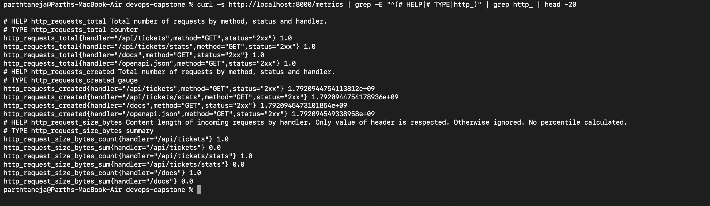

### `/metrics` endpoint (inside the cluster)

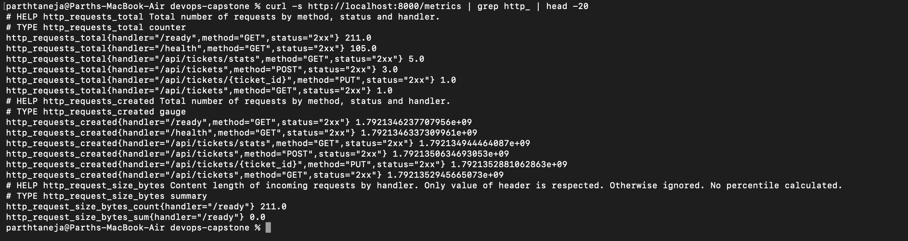

### Prometheus Targets — backend pods `UP`

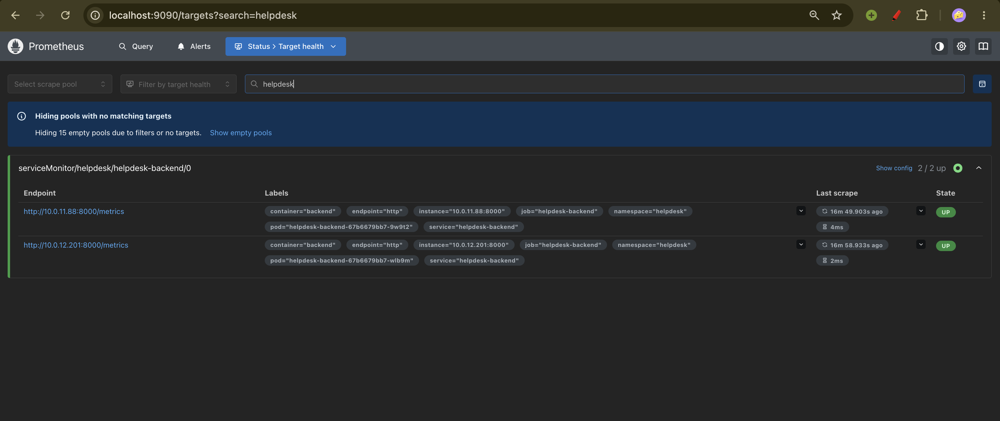

### Grafana dashboard with live metrics

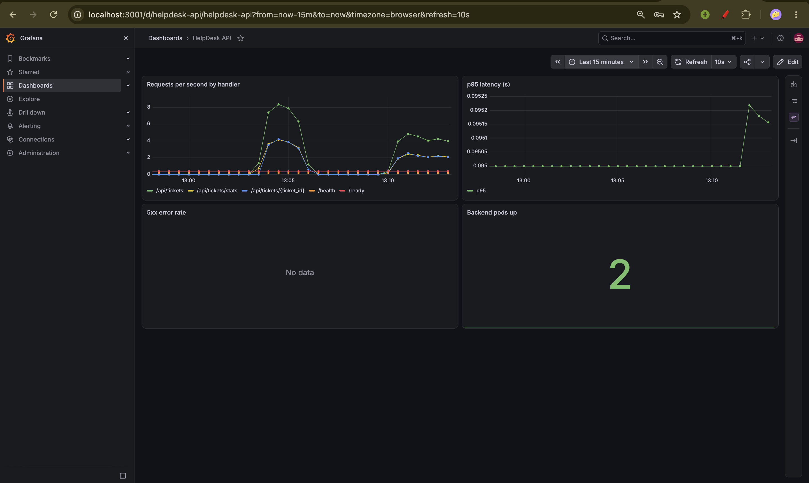

## 15. Module 10 — Live demo flow

The recorded demo ([watch it above](#2-demo-video)) shows the full loop:

1. The running app on EKS, reached through the ingress load balancer.
2. `kubectl get pods` and `helm list` for the deployed release.
3. A small code change committed and pushed to `main`.
4. The GitHub Actions run: pytest → build → Trivy → push to GHCR.
5. The new SHA-tagged image in GHCR.
6. `helm upgrade` to roll out the new image, then `kubectl rollout status`.
7. A browser refresh showing the updated app.

## 16. Cleanup and cost control

Delete the in-cluster resources first — the ingress load balancer and EBS volumes would otherwise block the VPC from deleting:

```bash
helm uninstall helpdesk -n helpdesk
helm uninstall ingress-nginx -n ingress-nginx
helm uninstall kube-prometheus-stack -n monitoring
kubectl delete pvc --all -n helpdesk
kubectl delete pvc --all -n monitoring
cd terraform && terraform destroy
```

Verify nothing is left (`aws eks list-clusters`, NAT gateways, Elastic IPs, load balancers, volumes in `ap-south-1`).

## 17. Troubleshooting notes

Problems hit during this project and their fixes:

| Problem | Cause | Fix |
|---------|-------|-----|
| CI: `Unable to resolve action aquasecurity/trivy-action@0.28.0` | Tag format changed to `v0.x.y` | Pinned `@v0.36.0` |
| Trivy failed on first local scan | Old Starlette and Alpine packages with HIGH CVEs | Upgraded dependencies and base images |
| EKS node group stuck `CREATING`, no instances | Free-tier account rejects `t3.medium` | Used `m7i-flex.large` |
| Postgres pod `Pending`, backend `CrashLoopBackOff` | EKS 1.31 has no default StorageClass | Applied `k8s/storageclass-gp3.yaml` (EBS CSI) |
| `kubectl` failing with a `libexpat` error | Homebrew AWS CLI Python build mismatch | `export DYLD_LIBRARY_PATH=/opt/homebrew/opt/expat/lib` |
